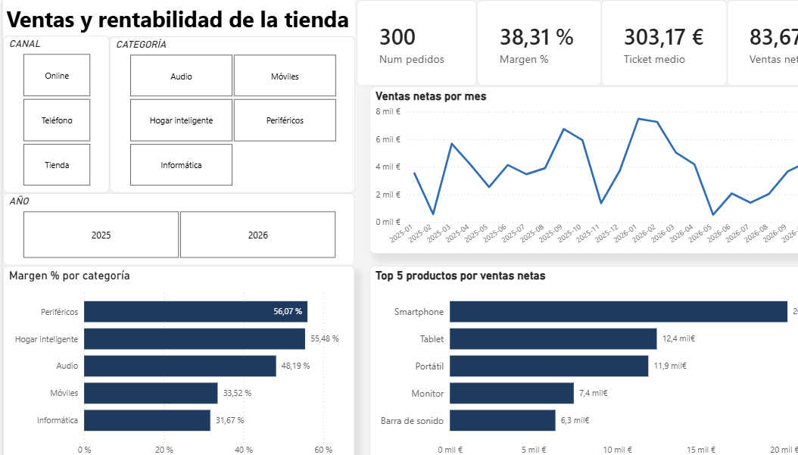

# Análisis de ventas de una tienda de tecnología (SQL + Power BI)

Proyecto de portfolio: respondo con **SQL (PostgreSQL)** a preguntas de negocio de una tienda ficticia y presento los resultados en un **dashboard de Power BI**.

**Estado:** completado (SQL y Power BI). Siguiente proyecto: análisis exploratorio con Python.



## Problema de negocio
El dueño de una tienda de tecnología tiene sus datos en una base de datos, pero no sabe qué productos y categorías le dejan más dinero, cuánto gana por cada euro vendido ni cómo evolucionan sus ventas. Este proyecto responde a esas preguntas y las presenta en un informe interactivo.

## Datos
Base de datos **sintética** (datos ficticios generados para practicar) con 6 tablas.
Periodo: enero 2025 – octubre 2026. 300 pedidos, 563 líneas de pedido y 40 clientes. Incluye casos límite a propósito: clientes sin pedidos, productos sin ventas, descuentos con valores nulos y pedidos cancelados.

## Modelo de datos
Relaciones (de varios a uno):
- `lineas_pedido` → `pedidos` (por `id_pedido`) y `productos` (por `id_producto`)
- `pedidos` → `clientes` (por `id_cliente`) y `tiendas` (por `id_tienda`)
- `productos` → `categorias` (por `id_categoria`)
- En Power BI se añade una tabla `Calendario` relacionada con `pedidos[fecha]`.

## Estructura del repositorio
- `sql/01_crear_base_datos.sql`: crea las tablas y carga los datos.
- `sql/02_consultas_negocio.sql`: JOINs, agregaciones y CTEs (5 preguntas de negocio).
- `sql/03_consultas_avanzadas.sql`: funciones de ventana (top 3 por categoría y crecimiento mensual con `LAG`).
- `powerbi/proyecto_SQL.pbix`: modelo y dashboard.
- `img/dashboard.png`: captura del dashboard.

## Cómo reproducirlo
1. Ejecuta `sql/01_crear_base_datos.sql` en PostgreSQL.
2. Ejecuta las consultas de los archivos 02 y 03.
3. Abre `powerbi/proyecto_SQL.pbix` con Power BI Desktop (Windows). Los datos están importados, así que se ve sin conectarse. Para actualizarlos, apunta el origen de datos a tu PostgreSQL local (**Transformar datos → Configuración del origen de datos**).

## Dashboard
Una página con:
- **4 KPIs:** número de pedidos, margen %, ticket medio y ventas netas.
- **Ventas netas por mes** (gráfico de líneas).
- **Top 5 productos** por ventas netas y **margen % por categoría** (gráficos de barras).
- **Filtros** por canal, categoría y año.

Medidas DAX principales:

```dax
Ventas netas =
SUMX(
    FILTER(lineas_pedido, RELATED(pedidos[estado]) <> "Cancelado"),
    lineas_pedido[cantidad] * RELATED(productos[precio]) * (1 - COALESCE(lineas_pedido[descuento], 0))
)

Ticket medio =
DIVIDE([Ventas netas], CALCULATE(COUNTROWS(pedidos), pedidos[estado] <> "Cancelado"))

Margen % = DIVIDE([Margen bruto], [Ventas brutas])
```

## Preguntas y hallazgos
| Pregunta | Hallazgo |
|---|---|
| Ventas netas por mes | Oscilan entre 531 € (mayo 2026) y 7.476 € (enero 2026). Los crecimientos mensuales son muy volátiles por el bajo volumen de pedidos (+880 % en marzo de 2025, −87 % en mayo de 2026). |
| Top 5 productos | Smartphone lidera las ventas netas (20.186 €); tres de los cinco primeros son de Informática (Tablet, Portátil y Monitor). |
| Top 3 por categoría | Líderes: Tablet (Informática), Smartphone (Móviles), Barra de sonido (Audio), Webcam (Periféricos) y Cámara de seguridad (Hogar inteligente). |
| Margen por categoría | Informática es la categoría que más margen deja (11.569 €), un 42 % más que Móviles (8.138 €). |
| Margen porcentual | Informática es la última en porcentaje (31,7 %); Periféricos (56,1 %) y Hogar inteligente (55,5 %) lideran. |
| Ticket medio | 303,17 € por pedido (sin cancelados). |
| Ventas por año | 2025: 45.709 € netos. 2026 (enero–octubre): 37.965 € netos. |

## Conclusiones y recomendaciones
**Conclusiones**
- **Informática vende mucho pero rinde poco por euro:** supone el 42 % de las ventas brutas y el 35 % del margen, con el menor margen porcentual (31,7 %).
- **Periféricos y Hogar inteligente rinden más por cada euro vendido:** suman el 14 % de las ventas brutas, pero el 21 % del margen, con márgenes superiores al 55 %.
- **Hay dependencia de un producto:** el Smartphone concentra el 24 % de las ventas netas.
- **Las ventas mensuales son muy irregulares**, aunque con pocos pedidos al mes (unos 14) las variaciones porcentuales se exageran.

**Recomendaciones** (ilustrativas, sobre datos sintéticos)
1. Impulsar la venta de Periféricos y Hogar inteligente, por ejemplo como complemento de portátiles y móviles.
2. Revisar costes y precios en Informática para mejorar su margen porcentual.
3. Reducir la dependencia del Smartphone reforzando otros productos de la categoría.
4. No planificar compras solo con el crecimiento mensual: haría falta más histórico.

## Validación: SQL frente a Power BI
Las mismas cifras en las dos herramientas comprueban que el modelo y las medidas son correctos.

| Indicador | SQL | Power BI |
|---|---|---|
| Ventas netas | 83.674,06 € | 83,67 mil € |
| Ticket medio | 303,17 € | 303,17 € |
| Margen % | 38,3 % | 38,31 % |
| Pedidos | 300 | 300 |

## Supuestos y limitaciones
- Los descuentos NULL se tratan como 0.
- Se excluyen los pedidos cancelados (24 de 300) de ventas, margen y ticket medio. `Num pedidos` cuenta los 300 pedidos, mientras que el ticket medio se calcula sobre los 276 no cancelados.
- El margen se calcula sobre el precio bruto, sin descuentos, así que no es directamente comparable con las ventas netas.
- Los pedidos pendientes cuentan como venta.
- Los datos son sintéticos y de poco volumen, así que las cifras son ilustrativas.

## Competencias demostradas
- **SQL (PostgreSQL):** JOINs de varias tablas, agregaciones, `GROUP BY`/`HAVING`, tratamiento de NULL, CTEs y funciones de ventana (`ROW_NUMBER`, `LAG`).
- **Power BI:** modelo de datos con tabla de fechas, medidas DAX (`SUMX`, `FILTER`, `RELATED`, `CALCULATE`, `DIVIDE`), diseño de dashboard con filtros y validación frente a SQL.

## Autor
Tirso Patón Suárez · Estudiante de Business Analytics (UNIE) · [github.com/TirsoPaton](https://github.com/TirsoPaton)
